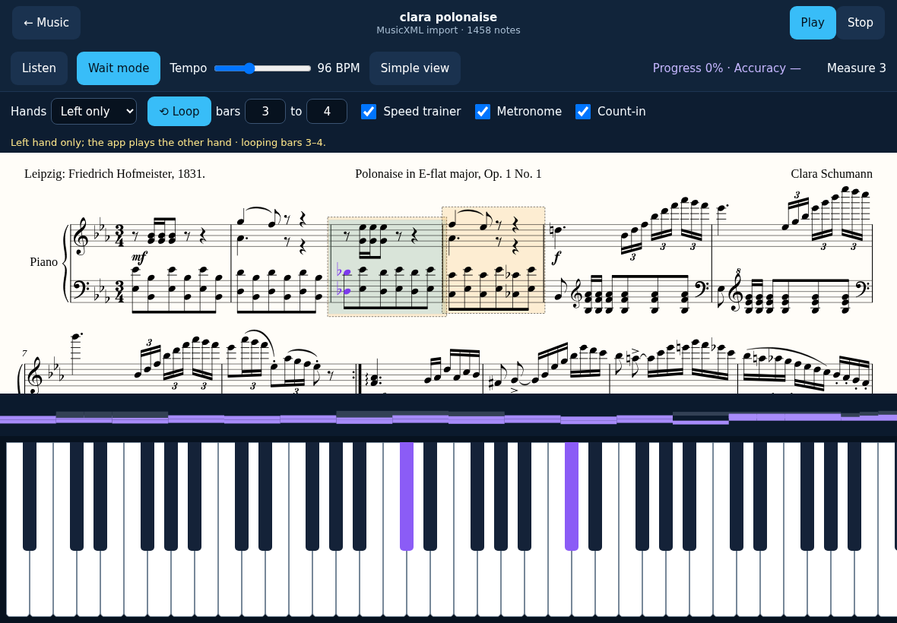

# Piano Companion 6.1

**Live app:** https://bezoon5.github.io/PianoApp

A piano practice app for iPad and desktop browsers. Import music, follow the engraved score, practise one hand at a time, loop the tricky bars with a speed trainer and metronome, and track your progress. It installs to the home screen and works offline.



## Getting music in
| Source | Accuracy | Notes |
|---|---|---|
| **MusicXML** (`.musicxml`, `.xml`, `.mxl`) | Exact | Recommended. Export from MuseScore, Sibelius, Finale or Dorico. Multi-part scores ask which part to practise (piano suggested). |
| **MIDI** | Exact notes | Notation is generated, so the display is approximate. |
| **Camera / Photos / PDF** | Good with AI recognition; needs review | Optical music recognition with a review-and-correct step. With a [recognition server](server/README.md) connected, pages are read by the homr neural network, which copes with real phone photos. Without one, a basic on-device recogniser is used (best with clean screenshots). |
| **Built-in** | – | 25 public-domain Christmas melodies and Happy Birthday. |

### AI recognition for photos (recommended)
Phone photos have shadows, tilt and page curl that the built-in recogniser can't handle reliably. For dependable results, run the small recognition server in [`server/`](server/README.md), which uses [homr](https://github.com/liebharc/homr). Google Cloud Run is recommended (normally within its free monthly allowance); setup takes about 15 minutes and one pasted command. Then in the app: **Settings → Photo recognition**, paste the server address and press **Test connection**. When scanning, choose **AI recognition** in the Layout step (it becomes the default once a server is set). If the server is unreachable, the app says so and falls back to the on-device recogniser.

Tips for good photos: lay the page flat, fill the frame, use even light, and use **Camera app (sharper)** for a full-resolution photo.

## Practising
- **Listen** or **Wait mode**. In Wait mode the app waits for the right note or chord and scores you.
- **Hands**: Both, Right only or Left only. The app plays the other hand; your hand's keys light up.
- **Loop**: choose bars (e.g. 12 to 16) and press **⟲ Loop**. Looped bars are shaded in the score.
- **Speed trainer** (with a loop): starts at 70% of your tempo and adds 5% per pass.
- **Metronome** and **count-in**.
- **Progress**: after each Wait-mode run you see accuracy, best score, recent sessions and your trickiest bars, each with **Loop this bar**. The library shows how often and how well you've practised each piece, plus your practice streak.
- Engraved sheet music (Verovio) with the current bar and notes highlighted; tempo 30–220 BPM; repeats played as written.
- Touch keyboard (61/76/88 keys); USB/Bluetooth MIDI keyboards in Chrome/Edge (not Safari on iPad). Grand piano or simple synth.

## Your library
- **Edit** on an imported piece lets you rename or delete it.
- **Settings → Back up library** saves all imported music and practice history to a file (keep it in Files, iCloud Drive or OneDrive). **Restore backup** loads it on any device.

## Install and offline
- **iPad/iPhone:** Safari → Share → *Add to Home Screen*. **Chrome/Edge:** install button in Settings or the address bar.
- Open **Settings → Make available offline** once while online to save the libraries, sheet-music engine and piano sound.

## Known limitations
- MusicXML: D.C./D.S./Coda jumps are not followed; cue and grace notes are not played.
- Scanning with AI recognition: dynamics, articulations, grace notes and repeat signs are not used; key and time-signature changes inside a piece should be checked. Review is still recommended.
- Scanning on this device only: ties, slurs, tuplets and accidentals next to notes are not recognised; review is required.
- Practice history is stored in the browser; use Backup to keep a copy.
- The sheet-music engine (~7 MB) downloads the first time it is used.

## Project structure
```
index.html, app.js, styles.css      app shell, library, practice, sound, settings
sw.js, manifest.webmanifest, icons/ installable offline app
music/practice.js                   hands, loops, speed trainer, metronome, progress, backup (pure logic)
music/xml.js, music/musicxml.js     MusicXML import/export
music/notation.js                   Verovio rendering, bar/note highlighting, loop marking
omr/                                optical music recognition and review workflow
omr/homr.js                         AI recognition: server client + MusicXML -> review score
server/                             recognition server (homr), Dockerfile, deploy guide
tests/                              Node tests, fixtures, browser suites, Verovio check
```

## Run and test
```
npm start                                   # http://localhost:8080
npm test                                    # 66 Node tests (all suites also run on GitHub for every pull request)
python3 tests/server/test_server.py         # recognition server API (stub homr; needs starlette, uvicorn, python-multipart, requests)
python3 tests/browser/homr.py               # AI recognition end to end (Playwright), 25 checks
pip install verovio && python3 tests/verovio_check.py
python3 tests/browser/server.py 8080 &      # browser suites (Playwright)
python3 tests/browser/practice6.py http://127.0.0.1:8080/index.html   # 29 checks
python3 tests/browser/stress.py    http://127.0.0.1:8080/index.html   # 34 checks
python3 tests/browser/offline.py   http://127.0.0.1:8080/index.html   # 7 checks
```

## Publishing
Upload the contents of this folder to the repository root, **including the `music/`, `omr/`, `server/`, `icons/`, `docs/` and `tests/` folders** (drag the folders in; the file picker skips folders). Then **Settings → Pages → Source: GitHub Actions**.

## Credits
[Tone.js](https://tonejs.github.io), [@tonejs/midi](https://github.com/Tonejs/Midi), [Salamander Grand Piano](https://archive.org/details/SalamanderGrandPianoV3) samples (CC-BY 3.0, Alexander Holm), [Verovio](https://www.verovio.org) (LGPL-3.0), [PDF.js](https://mozilla.github.io/pdf.js/), [Tesseract.js](https://tesseract.projectnaptha.com), all loaded from public CDNs. Photo recognition server: [homr](https://github.com/liebharc/homr) (AGPL-3.0, runs separately; see server/README.md). Test scores from the [music21](https://github.com/cuthbertLab/music21) corpus. Visual in this file was generated with Microsoft Copilot.
